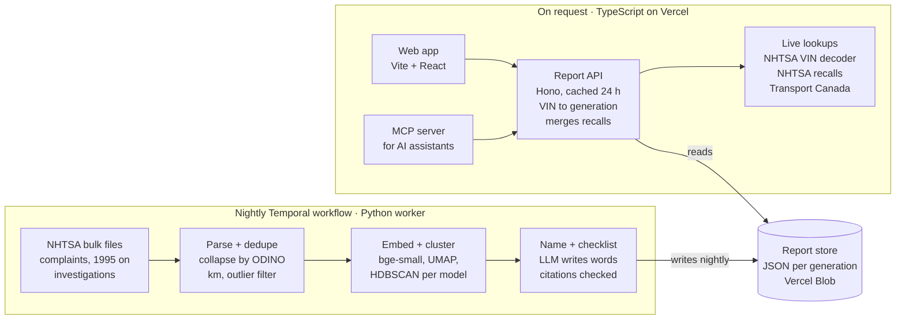
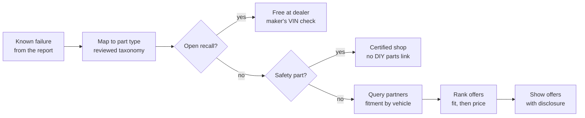

# Used-Car Risk Report — Project Plan

Nov 8, 2026 · Sal Anvarov · Live doc: https://claude.ai/artifact/MqnkTosn2MEE3zc17cizxU · PDF copy with the original diagrams: [lemon-check-project-plan.pdf](./lemon-check-project-plan.pdf)

## Overview

Build a free, open-source tool that turns a VIN into a used-car risk report from public government data, then write it up on the portfolio. Working name: **Lemon Check** (repo `msanvarov/lemon-check`).

**The problem.** Buyers pay about $40–60 for a vehicle-history report. It still doesn't say what tends to break on that model, or at what mileage. That information is public, but it's buried in raw government databases written as free-text complaints.

**What it does.** You paste a VIN and get one page:

- **The car:** make, model, year, engine and trim, decoded from the VIN.
- **Open recalls:** from both the US and Canadian databases, merged into one list.
- **Known failures:** owner complaints for that model and year, grouped by failure, with how often each happens and the typical mileage.
- **Pre-purchase checklist:** what to inspect or ask the seller, where every item links back to the complaints or recalls behind it.

From v1.1, each failure also gets a **Fix it** panel with parts that fit, from partner retailers (see Parts sourcing).

**Who it's for.** People buying a used car, mechanics doing a pre-purchase inspection, and AI assistants (through an MCP server).

**What it does not do.** It has no accident, ownership, odometer or title history; that data is proprietary. It reports risk for the model and year, plus open recalls, not the history of that one car. The README and the report page both say so.

## Data sources

All sources are free, need no API key and are public government data. Each endpoint below was tested on 2026-11-08 and returned data.

| Source | What it gives | How to use it | Format |
| --- | --- | --- | --- |
| [NHTSA vPIC VIN decoder](https://vpic.nhtsa.dot.gov/api/vehicles/DecodeVinValues/1HGCM82633A004352?format=json) | Make, model, year, engine, trim, plant, airbag layout from a 17-character VIN | Live call per report | JSON API |
| [NHTSA recalls by vehicle](https://api.nhtsa.gov/recalls/recallsByVehicle?make=honda&model=accord&modelYear=2003) | Recall campaigns for a make, model and year, with component, summary, remedy and "park it" flags | Live call, cached 24 h | JSON API |
| [NHTSA complaints by vehicle](https://api.nhtsa.gov/complaints/complaintsByVehicle?make=honda&model=accord&modelYear=2003) | Owner complaints with component and free-text summary (2,013 for a 2003 Accord) | Fallback only: it has **no mileage field** | JSON API |
| [NHTSA complaints bulk file](https://static.nhtsa.gov/odi/ffdd/cmpl/FLAT_CMPL.zip) | Every complaint since 1995, including mileage at failure (`MILES`) and the full description ([field list](https://static.nhtsa.gov/odi/ffdd/cmpl/CMPL.txt)) | Nightly ingest; the main source for clustering | Zipped tab-separated text, ~376 MB |
| [NHTSA investigations bulk file](https://static.nhtsa.gov/odi/ffdd/inv/FLAT_INV.zip) | Defect investigations opened by the regulator | Nightly ingest; shown as "under investigation" | Zipped text |
| [Transport Canada recalls](https://data.tc.gc.ca/v1.3/api/eng/vehicle-recall-database/recall/make-name/honda/model-name/accord/year-range/2003-2003?format=json) | Canadian recall numbers, dates and details by make, model and year | Live call, cached 24 h; merged with NHTSA recalls | JSON API (verbose name/value format) |

**Licensing.** NHTSA data is US federal government work and in the public domain. Transport Canada data is published under the Open Government Licence – Canada, which needs an attribution line on the page.

**Two limits to design around:**

- Neither recall API takes a VIN, so the report can't confirm whether this car's recall was already fixed. The page links to the maker's own VIN recall lookup for that final check.
- The bulk file stores only the first 11 VIN characters, which is enough to match on model and plant but not on a single car.

**Later, not v1:** NHTSA technical service bulletins (dealer repair notices) have a public field list ([TSBS.txt](https://static.nhtsa.gov/odi/ffdd/tsbs/TSBS.txt)), but the bulk download path still needs confirming.

## Architecture

Split the work in two. A nightly Temporal workflow, run by a Python worker, does all the heavy lifting and writes one JSON file per model generation. A thin TypeScript API serves those files and adds the live recall and VIN calls.



The report store is the only handoff: the batch side writes it and the request side only reads it, so either side can be rewritten without touching the other.

**Nightly workflow on Temporal.** A Temporal Schedule starts `NightlyRefresh` once a night. Each step is an activity, so a failed step retries on its own and the run resumes from there instead of reprocessing 1.6 million complaints.

1. `download_bulk_files`: stream the complaints and investigations zips, sending heartbeats so a stalled download gets retried. Skip the run if the files haven't changed since last night.
2. `parse_and_dedupe`: write a Parquet snapshot of the cleaned complaints.
3. Find the model generations with new complaints, and start one `RefreshGeneration` child workflow for each, a few at a time.
4. Each child runs `embed` → `cluster_and_score` → `label_and_checklist` → `validate_citations` → `write_report_json`. The LLM step gets a backoff retry policy for rate limits.
5. `publish_manifest`: write the index of generations last, so the API never serves half a run.

Pass file paths between activities, not the data itself, since Temporal caps payload size (2 MB by default).

| | Local development | Production |
| --- | --- | --- |
| Temporal server | `temporal server start-dev` from the Temporal CLI, with the web UI at localhost:8233 | Temporal Cloud namespace, connected later |
| Worker | `uv run python -m pipeline.worker` on your laptop | Long-running container; host still to decide |
| Trigger | By hand from the CLI or the web UI | Temporal Schedule, nightly |
| Report store | Local folder | Vercel Blob |

Switching is configuration only: `TEMPORAL_ADDRESS`, `TEMPORAL_NAMESPACE` and a Cloud API key, read from environment variables.

**Repo layout** (one monorepo, pnpm workspaces plus a uv-managed Python package)

```text
lemon-check/
  pipeline/            Python: Temporal workflows, activities and worker (temporalio SDK)
  packages/core/       shared report schema (zod), exported as JSON Schema for Python
  packages/mcp/        MCP server, runs with npx
  packages/parts/      partner adapters for parts sourcing (v1.1)
  apps/api/            Hono API on Vercel
  apps/web/            Vite + React report page
  data/generations.yaml
  .github/workflows/ci.yml   tests and lint only; the nightly run lives in Temporal
```

**MCP tools to expose:** `get_vehicle_report(vin)`, `list_known_issues(make, model, year)`, `get_recalls(make, model, year)` and, from v1.1, `find_parts(vin, issue_id)`. They return the same JSON the web page renders, so an assistant can answer "what should I check on this 2017 Civic?" with citations.

**Why this stack:** Python only where the ML needs it, and TypeScript everywhere else, matching the portfolio. Temporal gives retries, resume and a run history for the nightly job without writing that plumbing. Vercel's free tier covers the web traffic. Temporal Cloud is usage-priced ([pricing](https://temporal.io/pricing) lists about $50 per million Actions with no minimum), and one nightly run should be a small bill; confirm once real runs show the Action count.

## Core technique

The project stands out on one step: turning thousands of messy free-text complaints into a handful of named failures, each with a count and a typical mileage. Everything is precomputed per model and year, so a report is a database read plus two live recall calls.

1. **Normalize.** Parse the bulk file, keep vehicle complaints, and collapse rows that share one complaint number (`ODINO` repeats once per component). Treat mileage 0 as unknown (about half of all rows) and drop values above 500,000. Show km by default with a miles toggle, since the audience starts in Canada.
2. **Group by generation, not just year.** A 2018 and a 2019 of the same model usually share parts, so cluster across a small generation window (for example 2018–2022). Keep a hand-edited `generations.yaml` for the top 50 models and fall back to ±1 year.
3. **Embed.** Encode each description with a small open sentence-embedding model run locally (`bge-small` or `all-MiniLM-L6-v2`). It's free, reproducible, and anyone can rerun the pipeline without an API key.
4. **Cluster.** Run UMAP then HDBSCAN per generation (minimum cluster size about 5). Label each cluster with its top keywords (class-based TF-IDF, as in BERTopic), then ask an LLM for a short plain name such as "Transmission slips between 2nd and 3rd gear".
5. **Score.** For each cluster store the complaint count, its share of that model's complaints, median and middle-50% mileage, crash, fire and injury counts, and the years filed. Rank by share, with any crash or fire cluster pinned to the top.
6. **Write the checklist with citations.** Send the LLM the top clusters and recalls as JSON, each with an ID. Every checklist item must cite at least one cluster ID or recall number. Code then checks each citation exists and drops any item that cites nothing real. Results are cached per generation, so the LLM runs about once per model, not once per visitor.

**Evaluation.** Hand-label 200 complaints across 5 popular models and report cluster purity in the README and the blog post. This keeps the "it works" claim honest.

## Parts sourcing

Add a **Fix it** panel to each known failure: which part is usually involved, and where to buy one that fits this car. Start with affiliate programs, which need no deal, and pitch direct partnerships once there is traffic to show. Ship it as v1.1, two weeks after launch, so the core report isn't delayed.



Recall repairs are free at the dealer, so selling that part would cost the reader money. Airbags, seat belts and brake hydraulics go to a certified shop rather than a DIY parts link.

**How it works**

1. **Failure to part type.** Map each cluster to 0–3 part types from a small in-house list of about 150 ("ignition coil", "CV axle"). The LLM proposes the mapping and the nightly job stores it; review the top 50 models by hand.
2. **Vehicle details.** Year, make, model, engine and trim come from the VIN decoder the report already calls.
3. **Partner adapters.** One TypeScript adapter per partner in `packages/parts`, each returning the same offer shape: title, brand, price, currency, OEM or aftermarket, link and fit confidence.
4. **Fit confidence.** "Fit confirmed by retailer" when the partner filters by vehicle; "Keyword match: check fit at checkout" when it doesn't.
5. **Ranking.** Fit confidence first, then price. Commission never affects order, and the README says so.
6. **Links.** Clicks go through a `/go/:offerId` redirect that counts clicks per part type, never the VIN. Offers are fetched live and cached for a few hours, following each program's rules on showing prices.

**Partners**

| Partner | Market | Finding parts that fit | Affiliate route | Reported commission | Phase |
| --- | --- | --- | --- | --- | --- |
| [eBay Motors](https://ebaypartnernetwork.ebay.com/page/auto-parts-and-accessories) | US, Canada | [Browse API](https://developer.ebay.com/develop/guides-v2/inventory-discovery-and-refresh-guide) has a vehicle compatibility filter, though fitment is entered by sellers | eBay Partner Network | eBay's own example uses 3%; third parties report 1–5% | v1.1 |
| Amazon | US, Canada | No vehicle filter found for affiliates, so keyword match only | Amazon Associates | Check the current rate table | v1.1 (fallback) |
| [Advance Auto Parts](https://www.flexoffers.com/affiliate-programs/advance-auto-parts-affiliate-program) | US | Deep links by part type and vehicle | FlexOffers | 4%, 30-day cookie | v1.2 |
| [AutoZone](https://www.flexoffers.com/affiliate-programs/autozone-affiliate-program) | US | Deep links by part type and vehicle | FlexOffers | 0.8–3% (sources disagree) | v1.2 |
| [CarParts.com](https://www.flexoffers.com/affiliate-programs/carparts-com-affiliate-program/) | US | Deep links by part type and vehicle | FlexOffers or Impact | 0.8–12% (sources disagree) | v1.2 |
| RockAuto | US, Canada | Catalogue search link | [No affiliate program found](https://rockauto.knoji.com/questions/rockauto-affiliate-program/) | None: a plain link, kept because it's often cheapest | v1.1 |
| PartsAvatar, Canadian Tire, NAPA Canada | Canada | Not yet known | No public program found | — | Partnership pitch |

Commission rates come from affiliate directories, not the retailers, and conflict. Confirm each one in the network dashboard when you apply.

**Direct partnership pitch (after launch).** The pitch is high-intent buyers: the reader already knows which part fails, on which car. Ask for three things: a product and fitment feed in the industry formats (ACES and PIES), a better revenue share, and co-marketing. Canadian retailers come first, since none has a public program.

**Open-source fit.** Partner IDs live in environment variables, so the code stays neutral. Forks can use their own IDs or none, and with no IDs set the panel shows plain links. The MCP server gets a fourth tool, `find_parts(vin, issue_id)`.

**Disclosure.** Put a short "we earn a commission" line next to every offer list and on an about page. US (FTC) and Canadian (Competition Bureau) rules expect clear disclosure, and Amazon requires its own wording.

## Milestones

Plan for about seven weeks part-time to launch, plus two weeks for parts sourcing. The week-1 spike is the real test: if the clusters don't read as real failures, change the method before building anything around it.

| When | Phase | Scope | Gate before the next phase |
| --- | --- | --- | --- |
| Week 1 | Spike | Download the complaints file; cluster 3 popular models in a notebook. Pick the embedding model and minimum cluster size by reading the clusters | Clusters read as real failures for all 3 models |
| Weeks 2–3 | Data pipeline | Full ingest, dedupe, generations.yaml, clustering, scoring, cited checklist. JSON schema, nightly Temporal workflow on the local dev server, 200 labelled complaints | Top 50 models processed; cluster purity at least 80% on the labelled set |
| Weeks 4–5 | API and report page | Hono API: VIN decode, generation lookup, US and Canada recall merge, 24 h cache. Report page with failures, mileage chart, checklist and the disclaimer banner | 10 real VINs from friends and listings produce correct reports |
| Week 6 | MCP server and docs | MCP server with the three tools, published to npm; move the worker to Temporal Cloud. README with the method, evaluation results and limits | Works end to end in Claude Desktop and Claude Code |
| Week 7 | **Launch** | Blog post, portfolio card, Show HN and Reddit posts on the same morning. Pitch a talk to AI Meetup Toronto | Affiliate accounts approved; report page stable for 1 week after launch |
| Weeks 8–9 | Parts sourcing (v1.1) | Part-type mapping, eBay and Amazon adapters, RockAuto links, recall and safety checks. Fix it panel, click redirect, disclosure, find_parts MCP tool; then pitch retailers | — |

The purity target and week counts are estimates to revise after the spike.

**Start this week**

- [ ] Create the `lemon-check` repo with the folder layout above and an MIT licence
- [ ] Download the complaints bulk file and load it into DuckDB
- [ ] Pick 3 test models with lots of complaints (one Honda, one Ford, one Hyundai/Kia)
- [ ] Notebook: embed and cluster one model, then read 20 complaints from each cluster
- [ ] Install the Temporal CLI and run `temporal server start-dev`; trigger a hello-world workflow from the Python worker

## Risks and open questions

The biggest risk is a misleading report: popular cars get more complaints simply because more of them are on the road. The fixes below are cheap if they're designed in from the start.

| Risk | Why it matters | Mitigation |
| --- | --- | --- |
| Popularity bias | A best-selling model collects more complaints than a rare one with worse reliability | Never rank models against each other. Show each failure as a share of that model's own complaints |
| Reader reads it as this car's history | They may skip a real inspection | A banner on every report: "model risk, not this car's history", plus a link to the maker's VIN recall check |
| Messy or duplicate complaints | Inflated counts, nonsense clusters | Dedupe by complaint number, set a minimum cluster size, and publish the purity score |
| LLM invents a checklist item | A false claim about a real car brand | Every item must cite real IDs, checked in code. The LLM only writes wording, never the counts |
| Defamation-style claims about makers | Legal exposure for a public site | Report only counts and quotes from public records, link each one, and add a plain disclaimer |
| VIN privacy | Some users treat a VIN as personal data | Don't log full VINs. Cache by make, model and year, never by VIN |
| Hosting and compute cost | A personal project can't carry a big bill | Precompute in the nightly Temporal workflow, serve static JSON plus a small API, keep LLM calls in that workflow only, and reprocess only generations with new complaints |
| Upstream format changes | NHTSA has changed the file before (fields 50–51 added in April 2026) | Parse by header position with schema tests, and fail the workflow loudly before anything is published |
| Wrong part sold | Returns and lost trust, mostly from listings matched by keyword | Show fit confidence on every offer, rank retailer-confirmed fits first, and tell readers to confirm fit by VIN at checkout |
| Affiliate money looks like bias | Readers and HN commenters will question rankings | Rank in open code by fit then price, keep the no-commission RockAuto link, disclose next to every list |
| Affiliate program terms | Programs limit price caching and how links appear; a breach can close the account | Read each program's terms before building its adapter, and keep a short compliance note per partner in the repo |

**Open questions**

- [ ] Final project name: Lemon Check or something else? Check the domain and GitHub name
- [ ] Licence: MIT for the code; the data stays under its own terms
- [ ] Should v1 cover all makes, or start with the top 50 models sold in Canada and the US?
- [ ] Does Transport Canada publish owner complaints, or only recalls? Recalls are confirmed so far
- [ ] Which Canadian retailer to pitch first, and who to contact there?
- [ ] Should the hosted site keep affiliate income, or put it toward hosting and say so publicly?
- [ ] Where does the production Temporal worker run? It must be long-running with enough CPU for embeddings, for example a small VM or a Fly.io machine

## Blog and launch plan

Publish one long post on launch day, with the repo, live site and MCP server all ready the same morning. Working title: **"What Carfax won't tell you: turning 1.6 million government complaints into a free used-car risk report"**. The bulk file counted on 2026-11-08 holds 2,264,318 rows, which collapse to 1,631,342 unique complaints. 1,117,282 rows (49%) include mileage.

**Post outline**

1. **Hook:** the gap between a history report and "what breaks on this car", told through one real model with a known failure.
2. **The data:** what NHTSA publishes, what the files look like, and the mileage-only-in-bulk gotcha.
3. **From free text to failures:** embeddings, UMAP and HDBSCAN, shown on one model's clusters.
4. **When things break:** the mileage spread for each failure.
5. **Keeping the LLM honest:** the citation-checked checklist, with a rejected item shown as an example.
6. **How well it works:** cluster purity from the 200 hand-labelled complaints, and where it fails.
7. **Limits:** not vehicle history, popularity bias, recall status unknown per VIN.
8. **Try it:** live site, MCP server setup, how to contribute.

**Assets to make**

- [ ] Thumbnail at `public/assets/thumbnails/<post-uid>.svg`, matching the existing posts
- [ ] Pipeline diagram (the architecture section, simplified)
- [ ] A cluster chart and a mileage chart for one popular model
- [ ] Screenshot of a real report, plus a short clip of the MCP server answering in Claude

**Portfolio changes**

- [ ] New post in `content/posts/` with the same front matter as the other posts (category: Machine Learning, tag: Automotive)
- [ ] New card in the `tools` list in `src/i18n/opensource.json`, with `live`, `repo`, `media` and `post` set, like Reference Packer
- [ ] Card image at `public/assets/open-source/lemon-check.jpg`

**Distribution**

- Show HN with the live demo link
- Reddit: r/MachineLearning (method), r/whatcarshouldIbuy and r/PersonalFinanceCanada (the tool itself)
- LinkedIn post with the cluster chart
- A talk at AI Meetup Toronto, reusing the post's charts
- Submit the MCP server to the public MCP registries
